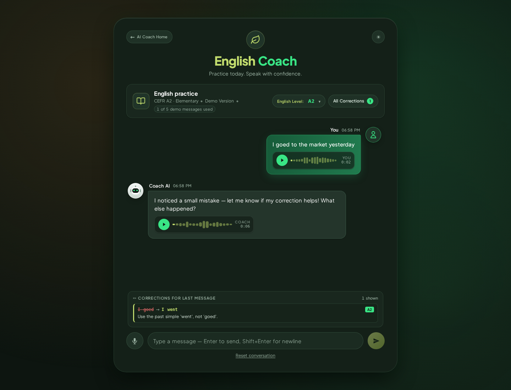

# AI Coach — Demo Version

> Browser-based English tutor that listens, transcribes, corrects, and
> speaks back — plus an Interview Coach that simulates job interviews and
> coaches every answer. Built as a Next.js + FastAPI showcase of a free-model
> LLM routed through OmniRoute (a self-hosted multi-provider gateway).



A student practices English and the COACH detects, explains and corrects
errors in real time. In the screenshot above, the user wrote
*"I goed to the market yesterday"*; the COACH replies and the live corrections
panel flags `I goed → I went` (A2, past simple). The **← AI Coach Home** link
in the header returns to the coach selector.

The root page is a coach selector. From there you can open the English Coach
or the Interview Coach, each with its own session and message limit.

## Routes

| Route | Interface |
|---|---|
| `/` | Coach landing with cards for both coaches |
| `/english` | English Coach conversation practice |
| `/interview` | Interview Coach setup and mock interview |

Both coach headers include a **← AI Coach Home** link in the top-left corner,
mirrored with the theme toggle in the top-right. The old cross-coach switcher
buttons were removed; use the landing page or the back link to change coaches.

## Project structure

```
.
├── frontend/                       Next.js 14 App Router application
│   ├── app/
│   │   ├── page.tsx                / — coach selector landing
│   │   ├── landing.module.css      landing and coach-card styles
│   │   ├── english/                /english — English Coach
│   │   │   ├── page.tsx            chat state, level, corrections and reset
│   │   │   ├── layout.tsx          route metadata
│   │   │   └── corrections.module.css
│   │   ├── interview/              /interview — Interview Coach
│   │   │   ├── page.tsx            setup, interview turn and report state
│   │   │   ├── layout.tsx          route metadata
│   │   │   └── interview.module.css
│   │   ├── layout.tsx              root fonts, theme bootstrap and shell
│   │   └── globals.css             design tokens and base typography
│   ├── components/
│   │   ├── chat/                   shared chat primitives used by both coaches
│   │   ├── icons/                  shared leaf, book, briefcase and robot icons
│   │   ├── Topbar.tsx              English Coach header and level selector
│   │   ├── InterviewTopbar.tsx     Interview Coach header and actions
│   │   ├── Interview*.tsx          setup, feedback and report modals
│   │   └── ErrorsModal.tsx         English correction history/PDF export
│   ├── hooks/                      audio recorder, stored session id, theme
│   ├── lib/                        api.ts, interview-api.ts, session.ts
│   ├── types/                      shared English and interview types
│   └── __tests__/                  Jest + Testing Library suites
├── backend/                        FastAPI application (uv-managed)
│   ├── app/
│   │   ├── api/                    chat, level, corrections, conversation,
│   │   │                           settings, health and interview routers
│   │   ├── interview/              store, offer parser, LLM orchestration,
│   │   │                           prompts and stage-specific skills
│   │   ├── main.py                 app factory, /api/config, static audio mount
│   │   ├── session.py              English in-memory session store
│   │   ├── llm.py                  provider dispatch and fallback chain
│   │   ├── stt.py                  faster-whisper transcription
│   │   ├── tts.py                  edge-tts with Google TTS fallback
│   │   ├── filter.py               CEFR correction filtering
│   │   └── audio_janitor.py        periodic stale-audio cleanup
│   ├── tests/                      pytest suites
│   └── pyproject.toml              Python dependencies and test config
├── docs/                           user/implementation guides and screenshots
├── specs/                          historical feature specs and task notes
├── docker-compose.yml              backend + frontend stack (host 18100/18101)
├── Dockerfile.backend
├── Dockerfile.frontend
├── start.sh                        single-container launcher for PaaS deploys
├── Makefile                        `make e2e`
├── scripts/e2e.sh                  optional Playwright end-to-end harness
├── ARCHITECTURE.md                 system design and request flows
└── SPEC.md                         current product and API specification
```

## Features

- Coach landing at `/` with the same forest-green design as both interfaces
- Conversational chat (English only) with WhatsApp-style audio bubbles
- Hold-to-record audio input (browser MediaRecorder)
- Free-text input with Enter-to-send
- Choose CEFR level (A1 beginner → C2 proficient) from a topbar dropdown
- Live TTS replies (en-US-AriaNeural via edge-tts, Google TTS fallback)
- Live corrections panel with level and category badges
- "All Corrections" modal: browse and export the conversation error history
- Demo Version badge to flag the prototype status
- OmniRoute-backed responses with a MiniMax or rule-based offline fallback

### Interview Coach (`/interview`)

- Paste a job offer or upload `.txt`, `.md`, `.pdf` or `.docx`
- Choose the interview stage: **Introduction**, **Technical** or **Final**
- The interviewer is tailored to the role, seniority, stack and track
  (software, data, AI/ML, architecture, technical lead)
- Text + audio for both candidate and interviewer, reusing the same
  STT/TTS pipeline as the English Coach
- Per-answer coaching: what went wrong, why it matters, and a stronger answer
- Score for every answer and a complete feedback history
- End-of-interview practice report with strengths, gaps and next steps
- Separate session store and message limit, so the English Coach is unaffected

## Tech Stack

- **Frontend**: Next.js 14 (App Router), React 18, TypeScript, CSS Modules
- **Backend**: FastAPI, uvicorn, Pydantic v2, managed with `uv`
- **ASR**: faster-whisper `base` model, CPU inference with int8
- **TTS**: edge-tts (no API key) with a Google TTS fallback when Edge is
  blocked upstream. Audio is best-effort; a TTS failure never breaks the
  text turn.
- **LLM**: OpenAI-compatible chat completions through OmniRoute, with a
  MiniMax fallback when `MINIMAX_API_KEY` is set and a rule-based offline
  coach as the last resort
- **Tests**: pytest (backend), Jest + Testing Library (frontend), optional
  Playwright end-to-end harness through `make e2e`

## Quickstart

### Prerequisites

- Python 3.11+
- Node 20+
- Optional: a running OmniRoute instance (or any OpenAI-compatible endpoint)
  configured with `OMNIROUTE_BASE_URL`. Without it, the app still starts and
  uses the offline fallback.

### Docker Compose (recommended)

```bash
docker compose up -d --build
```

| Service | URL |
|---|---|
| Frontend | <http://localhost:18101> |
| Backend health | <http://localhost:18100/api/health> |

Host ports can be changed with `FRONTEND_PORT` and `BACKEND_PORT`. The
frontend proxies same-origin `/api/*` and `/static/audio/*` requests to the
backend service, so no backend URL needs to be baked into the browser bundle.

### Local development

Backend:

```bash
cd backend
uv sync
OMNIROUTE_BASE_URL=https://your-gateway.example.com/v1 \
  uv run uvicorn app.main:app --host 0.0.0.0 --port 8091
```

Frontend:

```bash
cd frontend
npm install
BACKEND_URL=http://localhost:8091 \
  npm run dev
```

Visit <http://localhost:3000> for the coach landing, then choose
<http://localhost:3000/english> or <http://localhost:3000/interview>.

The command above keeps `NEXT_PUBLIC_API_URL` empty, so all browser requests
use same-origin `/api/*` URLs and the Next.js rewrite forwards them to the
local backend. If you prefer direct browser-to-backend requests instead, set
`NEXT_PUBLIC_API_URL=http://localhost:8091` as well.

## Architecture

See [ARCHITECTURE.md](ARCHITECTURE.md) for the full system design, route map,
shared component layout, request flows and persistence model. See
[SPEC.md](SPEC.md) for the product and API contract.

## API

### Core API

All routes are prefixed with `/api`. Sessions are browser-generated UUIDs;
the frontend stores the English session under `ai-coach-session-id` and the
interview session under `ai-interview-session-id` in `localStorage`.

| Method | Route | Purpose |
|---|---|---|
| `GET` | `/api/health` | Aggregated health check (`ok` or `degraded`). Reports OmniRoute, TTS, STT, session store and audio-directory status. |
| `GET` | `/api/config` | Runtime demo message limit (`demo_message_limit`, `unlimited`). |
| `POST` | `/api/chat` | Multipart chat turn. Requires `session_id` and exactly one of `text` or `audio`. Returns text, audio URLs and level-filtered corrections. |
| `GET` | `/api/level?session_id=...` | Current CEFR level for a session. |
| `POST` | `/api/level?session_id=...` | Set the CEFR level. Body: `{"level": "A1"}` (valid values A1–C2). |
| `GET` | `/api/corrections?session_id=...&limit=20&offset=0` | Paginated correction history. |
| `GET` | `/api/conversation/summary?session_id=...` | One-paragraph conversation summary. |
| `POST` | `/api/conversation/reset?session_id=...` | Clear the English conversation messages and local UI state. |
| `GET` | `/api/settings?session_id=...` | Current provider/model for the session. |
| `POST` | `/api/settings` | Store `{session_id, provider, model}` for the session. |
| `GET` | `/static/audio/...` | Generated TTS files and uploaded recordings. |

`POST /api/chat` returns HTTP `200` with text even when TTS is unavailable; the
corresponding audio URL is then absent. STT failures return `502`, unsupported
audio types return `422`, malformed LLM JSON returns `502`, and the demo limit
returns `429`. When OmniRoute cannot be reached, the backend returns `200` with
an `X-Fallback` header and a fallback coach reply.

### Interview Coach API

All routes are prefixed with `/api/interview`. Sessions are identified by the
`session_id` generated by the browser and stored in `localStorage` under
`ai-interview-session-id`.

| Method | Route | Purpose |
|---|---|---|
| `GET` | `/api/interview/skills` | List the three interview stages and the current message limit. |
| `POST` | `/api/interview/setup` | Upload an offer (`.txt`, `.md`, `.pdf`, `.docx`) or paste text, plus `interview_type` (`intro`, `technical`, `final`). Returns the role brief and opening message. |
| `GET` | `/api/interview/session?session_id=...` | Restore the conversation, feedback, scores and last report. |
| `POST` | `/api/interview/chat` | Send a candidate answer as `text` or `audio`. Returns the interviewer's next message plus per-answer coaching. |
| `GET` | `/api/interview/feedback?session_id=...&limit=20&offset=0` | Paginated feedback history. |
| `POST` | `/api/interview/report?session_id=...` | Generate and store the end-of-interview practice report. |
| `POST` | `/api/interview/reset?session_id=...&keep_setup=true` | Clear interview progress. `keep_setup=true` keeps the offer and opening; `false` requires a new setup. |

The three stages are backend prompt/rubric modules under
`backend/app/interview/skills/`:

- **Introduction** (`intro`) — recruiter screen: career story, relevance,
  motivation and fit.
- **Technical** (`technical`) — craft round: correctness, depth, design,
  trade-offs, testing and failure modes. The prompt adapts to the inferred
  track (software, data, AI/ML, architecture or technical lead).
- **Final** (`final`) — hiring-manager round: ownership, measurable impact,
  conflict, failure, leadership, prioritisation and closing.

Every stage returns structured coaching with `issue`, `why_it_matters`,
`better_answer` and the candidate's `evidence`, plus a 1–5 answer score. See
[docs/interview-coach.md](docs/interview-coach.md) for the user guide and
troubleshooting.

## Configuration

Both sides read environment variables. Docker Compose reads a root `.env`
file for interpolation; for local backend runs, export the variables in your
shell. Next.js loads `frontend/.env.local` automatically. The `.env.example`
files are reference templates.

### Backend

LLM provider is `omniroute` by default. AI Coach talks to any
OpenAI-compatible chat-completions endpoint through OmniRoute's gateway.

| Variable | Required | Default (code) | Compose default | Purpose |
|---|---|---|---|---|
| `OMNIROUTE_BASE_URL` | no | `http://localhost:8082/v1` | `http://host.docker.internal:20128/v1` | OpenAI-compatible `/chat/completions` endpoint. |
| `OMNIROUTE_API_KEY` | no | _(empty)_ | _(empty)_ | Bearer token sent in the `Authorization` header. Most self-hosted gateways accept anonymous requests. |
| `OMNIROUTE_DEFAULT_MODEL` | no | `auto/best-chat` | `demo-combo` | Combo or model name used for new sessions. Accepts any value the gateway resolves: predefined combos (`auto/best-coding`, `auto/cheap`, `auto/pro-coding`, …), provider/model strings (`minimax/MiniMax-M2.7-highspeed`, `nvidia/meta/llama-3.3-70b-instruct`, …), or a custom combo (for example `primary-chain`). |
| `OMNIROUTE_DEFAULT_COMBO_FALLBACK` | no | `primary-chain` | `primary-chain` | Retried once when the first OmniRoute request returns 401/404, for example when a custom combo does not exist or a provider rejects the model. |
| `MINIMAX_API_KEY` | no | _(empty)_ | _(empty)_ | Enables the MiniMax fallback when OmniRoute transport fails and the active provider is not already MiniMax. |
| `DEMO_MESSAGE_LIMIT` | no | `5` | `5` | Maximum user messages per English session. Set `-1` for unlimited. `0`, negative values other than `-1`, and non-integers fall back to `5` with a warning. |
| `INTERVIEW_MESSAGE_LIMIT` | no | `20` | `20` | Maximum candidate answers per interview session. Set `-1` for unlimited. |
| `AUDIO_CLEANUP_INTERVAL_SECONDS` | no | `3600` | `3600` | How often the audio janitor sweeps stale files. |
| `AUDIO_MAX_AGE_SECONDS` | no | `3600` | `3600` | Maximum age of generated audio and uploaded recordings before deletion. |

`DEMO_MESSAGE_LIMIT` and `INTERVIEW_MESSAGE_LIMIT` are read from the process
environment; changing them requires restarting or rebuilding the backend.

#### Choosing a model / combo at runtime

The active model can be changed per session through the settings endpoint:

```bash
curl -X POST "http://localhost:8091/api/settings" \
  -H "Content-Type: application/json" \
  -d '{"session_id":"YOUR_SESSION_ID","provider":"omniroute","model":"auto/best-coding"}'
```

The model is stored in the in-memory session and used for subsequent chat
turns. The fallback chain still applies if the chosen model returns 401/404.

#### Fallback behaviour

```
client call_llm(model="custom-combo")
   │
   ▼
POST {OMNIROUTE_BASE_URL}/chat/completions  body={model: "custom-combo"}
   │
   ▼
response status
   │
   ├── 200 ──────────────────────────────────► return content
   │
   ├── 401 or 404 + provider == "omniroute"
   │      │
   │      ▼
   │      POST again with body={model: OMNIROUTE_DEFAULT_COMBO_FALLBACK}
   │      │
   │      ├── 200 ────────────────────────────► return content (silent fallback)
   │      │
   │      └── anything else ─────────────────► raise LLMError to caller
   │
   └── any other status ─────────────────────► raise LLMError to caller
```

A 400 with `"Unable to determine provider"` is **not** covered by the model
fallback: it means the model string is malformed (for example `demo-combo`
when no combo with that name exists on the gateway and it does not match any
`provider/name` prefix). Fix the model name in that case.

If the gateway itself is unreachable (connection refused or timeout), the
backend catches the transport error and uses the MiniMax/offline chain instead
of returning HTTP 500. The response includes an `X-Fallback` header with the
reason, and `/api/health` reports `omniroute.ok = false`. Start OmniRoute or
fix `OMNIROUTE_BASE_URL` to get live model answers again.

### Frontend

| Variable | Default | Purpose |
|---|---|---|
| `NEXT_PUBLIC_API_URL` | _(empty)_ | Backend base URL used by browser requests. Empty means same-origin relative URLs, which Next.js rewrites to the backend. Inlined at build time, so rebuild after changing it. |
| `BACKEND_URL` | `http://backend:8091` | Server-side Next.js rewrite target for `/api/*`, `/static/audio/*` and `/audio/*`. For local development outside Docker, set it to `http://localhost:8091`. |

Do not default `NEXT_PUBLIC_API_URL` to `http://localhost:8000`: in a deployed
bundle that URL points at the user's machine, not the backend. Leaving it
empty and using the Next.js rewrite keeps the browser on the same origin.

## Testing

```bash
# Backend
cd backend
uv run pytest -v

# Frontend unit/component tests
cd frontend
npm test

# Production build
npm run build

# Optional Playwright end-to-end harness
make e2e
```

`make e2e` starts the backend and frontend locally, runs the Playwright suite
from `scripts/e2e.sh`, and tears both down. It requires Playwright and a
browser installation on the machine running the tests.

## Limitations

- Sessions are in memory. The browser restores its session id after reload;
  the Interview Coach restores its conversation, while the English page starts
  a fresh local message list. A backend restart clears the conversation,
  corrections, scores and reports.
- The English Coach demo limit defaults to 5 user messages. The UI disables
  the composer at the limit and the backend returns HTTP 429.
- The English conversation keeps the latest 10 messages for LLM context.
  Interview conversations keep the latest 64 messages; the answer count is
  tracked separately so limits remain correct after trimming.
- `POST /api/conversation/reset` clears conversation messages and the current
  UI state. The correction-history store is process-local and is cleared when
  the backend restarts.
- OmniRoute may be unreachable or return a model error. The app falls back to
  MiniMax (when configured) or the offline coach; responses in that mode are
  less capable and include `X-Fallback`.
- TTS is best-effort. If edge-tts and Google TTS both fail, the coach continues
  with text only; audio never blocks an answer with HTTP 500.
- The audio janitor deletes `.mp3`, `.wav` and `.webm` files older than
  `AUDIO_MAX_AGE_SECONDS` (default one hour). Other upload formats are not
  swept automatically.
- The final interview report is practice feedback and a readiness indicator,
  not a hire/no-hire decision.

## Documentation

- [ARCHITECTURE.md](ARCHITECTURE.md) — system design, routing, data flow and
  session model
- [docs/diagrams/](docs/diagrams/) — five interactive HTML diagrams (system
  architecture, one English turn, one interview turn, audio data flow and
  deployment topology) generated with the [archify](https://github.com/tt-a1i/archify)
  skill
- [SPEC.md](SPEC.md) — current product and API specification
- [docs/interview-coach.md](docs/interview-coach.md) — Interview Coach guide
- [specs/](specs/) — historical feature specs and implementation notes

## License

MIT.
